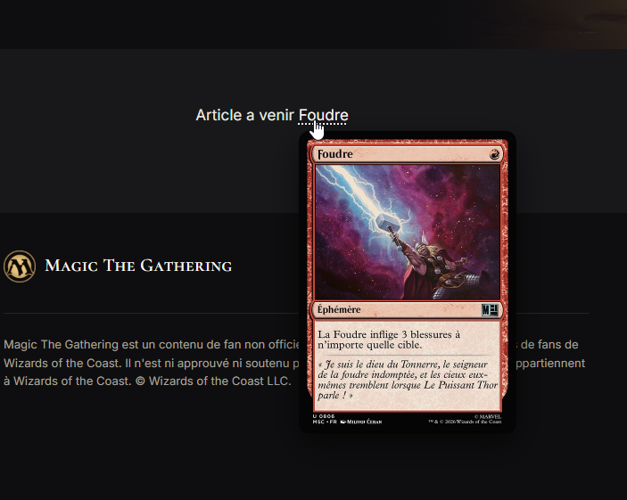
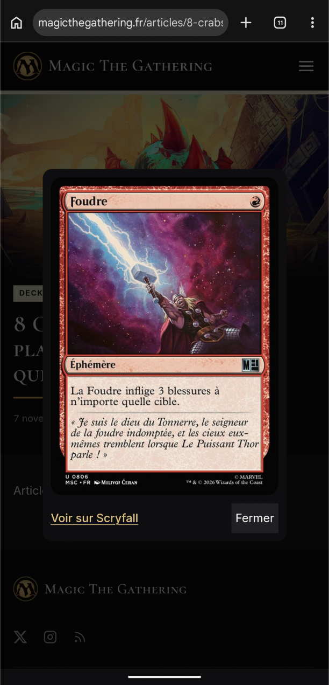

# Scryfall Tooltip

[](https://github.com/Exe64/grav-plugin-scryfall-tooltip/actions/workflows/ci.yml)

Grav plugin: Magic: The Gathering card names that show the card image from
[Scryfall](https://scryfall.com) on hover, keyboard focus or tap. Used on [magicthegathering.fr](https://magicthegathering.fr).

| Hover or keyboard focus | Tap on a touch screen |
|---|---|
|  |  |

Captures from [magicthegathering.fr](https://magicthegathering.fr). Card images and names are © Wizards of the Coast, served by Scryfall.

## Installation

Requires Grav 2.2+ and the [shortcode-core](https://github.com/getgrav/grav-plugin-shortcode-core) plugin (installed with it by gpm).

```
bin/gpm install scryfall-tooltip
```

Manual install: copy this repository to `user/plugins/scryfall-tooltip`, and install `shortcode-core`. There is no setting besides `enabled`.

## Usage

```
[carte]Foudre[/carte]                          French name: French printing
[card]Lightning Bolt[/card]                    English name: English printing
[carte="Lightning Bolt"]deux Foudres[/carte]   shown text differs from the card name
```

- Each name becomes a link to the card on Scryfall (exact search), so it works without JavaScript.
- The browser asks Scryfall for the image only when the reader hovers, focuses or taps the name:
  no request, no cookie, nothing third-party before that. Nothing is stored on the server.
- On touch screens the first tap opens the card in a centred sheet with a link to Scryfall; a tap
  outside, the close button or Escape closes it.
- To show the syntax itself in an article (inline code or a code block), wrap it in shortcode-core's
  `[raw]…[/raw]`: shortcodes are processed before Markdown, code included.
- Interface text in French when the page is `lang="fr"`, English otherwise.
- Styles use the theme's custom properties when present (`--band-raise`, `--on-band`, `--accent-hover`).

Card images and names are © Wizards of the Coast, served by Scryfall;
this plugin ships neither. Code under the MIT licence.
